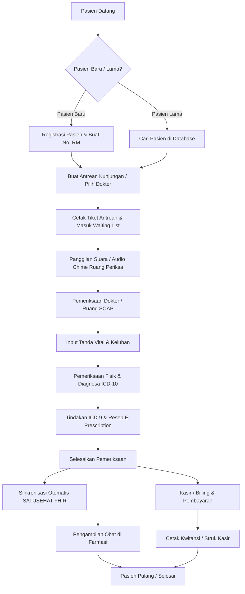

# 🏥 Dokumentasi Frontend: RME Klinik (`pm-frontend`)

> **Sistem Rekam Medis Elektronik (RME) & Manajemen Klinik Modern** untuk Klinik Pratama, Dokter, Bidan, dan Perawat di Indonesia.  
> Dirancang sesuai regulasi **Permenkes No. 24 Tahun 2022** tentang Rekam Medis Elektronik, terintegrasi standar interoperabilitas **Kemenkes SATUSEHAT (HL7 FHIR)** dan **BPJS Kesehatan (PCare & Antrean Online)**.

----

## 📑 Daftar Isi
1. [Ikhtisar Proyek](#-ikhtisar-proyek)
2. [Tech Stack & Arsitektur](#-tech-stack--arsitektur)
3. [Fitur Unggulan Sistem](#-fitur-unggulan-sistem)
4. [Daftar Modul & Navigasi Halaman](#-daftar-modul--navigasi-halaman)
5. [Alur Kerja Klinis (Clinical Workflow)](#-alur-kerja-klinis-clinical-workflow)
6. [Struktur Direktori Proyek](#-struktur-direktori-proyek)
7. [Integrasi Eksternal & Standar Medis](#-integrasi-eksternal--standar-medis)
8. [Manajemen Hak Akses (RBAC) & Mode Operasional](#-manajemen-hak-akses-rbac--mode-operasional)
9. [Panduan Instalasi & Menjalankan](#-panduan-instalasi--menjalankan)
10. [Variabel Lingkungan (.env.local)](#-variabel-lingkungan-envlocal)
11. [Akun Demo & Simulasi Login](#-akun-demo--simulasi-login)

---

## 🌟 Ikhtisar Proyek

Aplikasi **`pm-frontend`** adalah antarmuka web modern berbasis **Next.js 16 (App Router)** dan **React 19** yang menyediakan solusi menyeluruh untuk operasional fasilitas pelayanan kesehatan primer dan praktik dokter mandiri.

Aplikasi ini mendukung dua mode operasional:
- **Mode Klinik Dokter Mandiri (`DOCTOR_ONLY`)**: Alur kerja ringkas dan mandiri di mana dokter menangani sendiri pendaftaran, pemeriksaan SOAP, peresepan, hingga kasir.
- **Mode Klinik / Kolaborasi (`DOCTOR_AND_ADMIN`)**: Alur kerja tim dengan pembagian tugas antara Admin/Resepsionis, Perawat/Bidan, Dokter Pemeriksa, Kasir, dan Petugas Farmasi.

---

## 🛠 Tech Stack & Arsitektur

| Komponen | Teknologi / Library | Keterangan |
|---|---|---|
| **Framework** | [Next.js 16.3.3](https://nextjs.org/) | App Router, Server & Client Components |
| **Library UI** | [React 19.2.8](https://react.dev/) | Versi stabil terbaru React dengan performa rendering optimal |
| **Bahasa** | [TypeScript 5](https://www.typescriptlang.org/) | Strict type checking & end-to-end interface definition |
| **Styling** | [Tailwind CSS v4](https://tailwindcss.com/) | `@tailwindcss/postcss` modern clinical light aesthetic (`#f8fafc`) |
| **Ikonografi** | [Lucide React](https://lucide.dev/) | Ikon medis dan navigasi SVG teroptimasi |
| **Notifikasi** | [Sonner](https://sonner.emilkowal.ski/) | Toast notification interaktif, rich color feedback |
| **Audio Engine** | Web Audio API + SpeechSynthesis | Lonceng pemanggil antrean sintetis (E5, G#5, B5, E6) & Text-to-Speech bahasa Indonesia |
| **State Management** | React Context (`RMEProvider`) | State terpadu dengan persistensi otomatis `localStorage` (`rme_*_v3`) |
| **Koneksi Backend** | Fetch API Client (`lib/api-client.ts`) | Hybrid architecture: Local offline-first + sinkronisasi NestJS API (`/api/auth`, `/api/health`) |

---

## ✨ Fitur Unggulan Sistem

- **SOAP Rekam Medis Terstandar**: Anamnesis, Tanda Vital, Pemeriksaan Fisik, Diagnosis (ICD-10), Tindakan (ICD-9-CM), dan Resep Obat.
- **Kalkulator BMI Otomatis**: Menghitung Body Mass Index dan kategori gizi (Underweight, Normal, Overweight, Obesitas) secara otomatis dari Tinggi & Berat Badan.
- **E-Prescription & Racikan Fleksibel**:
  - Resep non-racikan dengan aturan pakai (signa) terstandar.
  - Resep racikan multi-komposisi (Puyer, Kapsul, Salep, Sirup) dengan dukungan dosis desimal dan biaya tuslah/embalase.
- **Mesin Antrean Suara (Audio Queue Caller)**:
  - Sintesis lonceng 4-nada khas rumah sakit menggunakan Web Audio API murni (tanpa perlu aset file audio eksternal).
  - Panggilan suara nama poli dan nomor antrean dalam bahasa Indonesia natural.
- **Layar TV Antrean Ruang Tunggu (`/queue/display`)**: Layar penuh untuk TV display ruang tunggu dilengkapi jam WIB real-time, tanggal, running text info klinik, dan indikator panggilan.
- **Kasir & Billing Multi-Metode**:
  - Penghitungan subtotal, diskon item/faktur (persen atau nominal), dan pajak.
  - Metode pembayaran: Tunai (dengan hitung uang diterima & kembalian), QRIS, Transfer Bank, BPJS Kesehatan, Asuransi Swasta.
  - Cetak struk/kwitansi (dukungan kertas thermal 58mm/80mm & A4).
- **Asisten AI Klinis (Clinical Chatbot Assistant)**: Rekomendasi diagnosis banding, cek kontraindikasi obat, dan panduan dosis.
- **Farmasi & Stock Opname**: Pencatatan stok obat, audit fisik vs sistem, hitung selisih unit & nilai rupiah, serta riwayat penyesuaian inventaris.
- **Laporan & Analitik**:
  - 10 Besar Penyakit Terbanyak (Morbilitas ICD-10).
  - Tren kunjungan pasien harian, bulanan, dan tahunan.
  - Laporan pendapatan kotor, omzet obat, dan jasa medis tindakan.
  - Rekap honorarium dan bagi hasil dokter per tindakan.

---

## 📂 Daftar Modul & Navigasi Halaman

```
┌─────────────────────────────────────────────────────────────┐
│                       MODUL UTAMA                           │
├───────────────────┬─────────────────────────────────────────┤
│ /dashboard        │ Ringkasan statistik, monitoring antrean │
│ /registration     │ Pendaftaran pasien baru & antrean poli  │
│ /queue            │ Manajemen panggilan antrean & cetak     │
│ /queue/display    │ Layar TV Display antrean ruang tunggu   │
│ /examination/:id  │ Ruang periksa dokter (SOAP & E-Resep)   │
│ /medical-record   │ Arsip data rekam medis pasien           │
│ /patients         │ Database master pasien & riwayat        │
│ /medications      │ Inventaris obat, harga, & stock opname  │
│ /billing          │ Kasir, daftar tagihan, & pembayaran     │
│ /reports          │ Laporan klinis, keuangan, & honorarium  │
│ /settings         │ Konfigurasi faskes, user, BPJS, SATUSEHAT│
└───────────────────┴─────────────────────────────────────────┘
```

### Rincian Sub-Modul Pengaturan (`/settings`):
- `/settings` (Utama): Profil Faskes, Kop Surat, SIP Dokter, Alamat, dan Tarif Konsultasi Dasar.
- `/settings/mode`: Pengalihan mode operasi (`DOCTOR_ONLY` vs `DOCTOR_AND_ADMIN`).
- `/settings/doctors`: Manajemen data dokter, spesialisasi, SIP, STR, kuota harian, dan IHS Practitioner.
- `/settings/nurses`: Manajemen data perawat, bidan, SIKP, STR, dan ruangan.
- `/settings/procedures`: Master tindakan medis dan tarif layanan.
- `/settings/icd10`: Master diagnosis ICD-10 beserta penanda penyakit kronis.
- `/settings/icd9`: Master prosedur medis terstandar ICD-9-CM.
- `/settings/snomed`: Master terminologi klinis SNOMED-CT.
- `/settings/satusehat`: Kredensial Kemenkes SATUSEHAT FHIR (Auth, Org ID, Client Secret, Pemetaan Resource & Log).
- `/settings/bpjs`: Konfigurasi BPJS Bridging (PCare & Antrean Online, Cek Kepesertaan).
- `/settings/users`: Manajemen akun staf & matriks perizinan RBAC (Role-Based Access Control).

---

## 🔄 Alur Kerja Klinis (Clinical Workflow)



---

## 📁 Struktur Direktori Proyek

```text
pm-frontend/
├── app/                             # Next.js 16 App Router Pages
│   ├── billing/                     # Kasir & Riwayat Pembayaran
│   │   ├── [visitId]/page.tsx       # Detail tagihan spesifik kunjungan
│   │   └── page.tsx                 # Daftar seluruh invoice & status bayar
│   ├── dashboard/page.tsx           # Dashboard analitik & monitor antrean
│   ├── examination/                 # Modul Pemeriksaan Dokter
│   │   └── [visitId]/page.tsx       # Form SOAP, ICD-10, Tindakan, Resep
│   ├── login/page.tsx               # Halaman Login Multi-Role & Quick Demo
│   ├── medical-record/page.tsx      # Arsip & Pencarian Riwayat Rekam Medis
│   ├── medications/page.tsx         # Manajemen Obat & Stock Opname Farmasi
│   ├── patients/                    # Master Data Pasien
│   │   ├── [id]/page.tsx            # Detail pasien & timeline riwayat
│   │   └── page.tsx                 # Tabel master pasien & filter
│   ├── payment/page.tsx             # Modul pemrosesan pembayaran kasir
│   ├── queue/                       # Antrean Pasien
│   │   ├── display/page.tsx         # Layar TV Antrean Ruang Tunggu
│   │   ├── ticket/page.tsx          # Cetak tiket antrean thermal
│   │   └── page.tsx                 # Meja antrean & pemanggil suara
│   ├── registration/page.tsx        # Registrasi pasien & antrean baru
│   ├── reports/                     # Laporan & Statistik
│   │   ├── honorarium/page.tsx      # Laporan jasa medis & honor dokter
│   │   ├── revenue/page.tsx         # Laporan omzet & keuangan
│   │   ├── stock-opname/page.tsx    # Laporan riwayat stock opname
│   │   ├── visits/page.tsx          # Laporan kunjungan & 10 besar penyakit
│   │   └── page.tsx                 # Pusat navigasi laporan
│   ├── settings/                    # Konfigurasi Sistem & Master Data
│   │   ├── account/page.tsx         # Profil akun pengguna
│   │   ├── bpjs/page.tsx            # Integrasi BPJS PCare & Antrean
│   │   ├── doctors/page.tsx         # Master data dokter & jadwal
│   │   ├── icd10/page.tsx           # Master ICD-10
│   │   ├── icd9/page.tsx            # Master ICD-9-CM
│   │   ├── mode/page.tsx            # Pilihan mode operasional klinik
│   │   ├── nurses/page.tsx          # Master perawat & bidan
│   │   ├── procedures/page.tsx      # Master tindakan medis & tarif
│   │   ├── satusehat/page.tsx       # Kemenkes SATUSEHAT FHIR config & log
│   │   ├── snomed/page.tsx          # Master terminologi SNOMED-CT
│   │   ├── users/page.tsx           # Manajemen staf & hak akses RBAC
│   │   └── page.tsx                 # Profil Faskes & Kop Surat
│   ├── globals.css                  # Style global & Tailwind base layer
│   ├── layout.tsx                   # Root layout, Google Font, Sonner toaster
│   └── page.tsx                     # Root redirector (Auth guard)
├── components/                      # Reusable UI & Feature Components
│   ├── ai/                          # Clinical chatbot assistant
│   ├── billing/                     # Billing summary, payment modal, receipt
│   ├── dashboard/                   # Stat cards, queue table
│   ├── examination/                 # Diagnosis selector, prescription, vital signs
│   ├── layout/                      # Header, sidebar navigasi responsif
│   ├── patients/                    # Patient table, patient modal, timeline
│   ├── queue/                       # Queue ticket modal & audio trigger
│   ├── trial/                       # Trial indicator, banner, & license modal
│   └── ui/                          # Button, Card, Badge, Input, Table, dll.
├── context/
│   └── rme-context.tsx              # Provider state global RME & data lifecycle
├── lib/
│   ├── api-client.ts                # HTTP client & auth header helper ke backend
│   ├── audio-announcer.ts           # Web Audio chime generator & Indonesian TTS
│   ├── indonesia-regions.ts         # Data wilayah administrasi Indonesia
│   ├── mock-data.ts                 # Master mock data pasien, obat, diagnosa
│   ├── report-mock-data.ts          # Mock data riwayat kunjungan & laporan
│   ├── stock-opname-mock-data.ts    # Mock data sesi audit stok
│   └── utils.ts                     # Helper format rupiah, tanggal WIB, nomor RM
├── types/
│   └── rme.ts                       # Definisi TypeScript komprehensif (SOAP, ICD, FHIR)
├── public/                          # Aset statis & logo
├── package.json                     # Daftar paket dependensi
└── tsconfig.json                    # Konfigurasi compiler TypeScript
```

---

## 🌐 Integrasi Eksternal & Standar Medis

### 1. Kemenkes SATUSEHAT (Interoperabilitas FHIR HL7)
Sistem telah disiapkan untuk mendukung pemetaan sumber daya FHIR standar Kementerian Kesehatan RI:
- `Encounter`: Kunjungan pasien dan waktu pelayanan.
- `Condition`: Diagnosis primer dan sekunder berkode ICD-10.
- `Observation`: Hasil tanda-tanda vital (tekanan darah, nadi, suhu, pernapasan, BMI).
- `Procedure`: Tindakan medis berkode ICD-9-CM.
- `MedicationRequest` & `Medication`: Peresepan obat dan sediaan farmasi.
- `Location` & `Organization`: Identitas faskes terdaftar di Kemenkes.
- Dilengkapi dengan fitur **Audit Log Transmisi** (`satuSehatLogs`) untuk memantau status keberhasilan pengiriman JSON payload FHIR.

### 2. BPJS Kesehatan (PCare & Bridging Antrean)
- Mendukung pengecekan nomor kartu peserta / NIK secara instan.
- Pencatatan log bridging pengiriman antrean faskes tingkat pertama (FKTP).

### 3. Klasifikasi Penyakit & Terminologi Klinis
- **ICD-10**: Klasifikasi internasional statistik penyakit dan masalah kesehatan terkait.
- **ICD-9-CM**: Prosedur dan tindakan medis operatif/non-operatif.
- **SNOMED CT**: Standardized Clinical Terminology untuk pencatatan gejala dan temuan fisik.

---

## 👥 Manajemen Hak Akses (RBAC) & Mode Operasional

Aplikasi memiliki matriks peran dengan batasan modul yang ketat:

| Peran (Role) | Hak Akses Utama |
|---|---|
| **SUPERADMIN** | Akses penuh ke seluruh modul, konfigurasi faskes, integrasi API, dan hak akses user. |
| **DOCTOR** | Akses ruang pemeriksaan SOAP, riwayat rekam medis, input diagnosa/tindakan/resep, dan laporan klinis. |
| **ADMIN / RESEPSIONIS** | Pendaftaran pasien baru/lama, meja antrean, panggilan antrean, dan pengaturan dasar. |
| **NURSE / BIDAN** | Skrining tanda vital awal, pendampingan pemeriksaan, dan antrean poli. |
| **PHARMACIST** | Manajemen obat, telaah resep dokter, penyiapan racikan, dan audit stock opname. |

---

## 🚀 Panduan Instalasi & Menjalankan

### Prasyarat:
- **Node.js**: Versi `>= 20.0.0` (disarankan LTS)
- **Package Manager**: `npm`, `pnpm`, atau `yarn`
- **Backend API (Opsional)**: `pm-backend` aktif di port `3001` (jika ingin menggunakan sinkronisasi database PostgreSQL & auth terpusat).

### Langkah-langkah:

1. **Buka Terminal & Masuk ke Direktori Proyek**:
   ```bash
   cd D:/Sinau/nafada/praktik-mandiri/pm-frontend
   ```

2. **Pasang Dependensi**:
   ```bash
   npm install
   ```

3. **Jalankan Server Development**:
   ```bash
   npm run dev
   ```

4. **Akses Aplikasi**:
   Buka browser di [http://localhost:3000](http://localhost:3000).

5. **Build untuk Produksi**:
   ```bash
   npm run build
   npm run start
   ```

---

## ⚙️ Variabel Lingkungan (.env.local)

Buat file `.env.local` pada direktori root `pm-frontend`:

```env
# Alamat URL Server Backend NestJS
NEXT_PUBLIC_API_URL=http://localhost:3001/api

# Konfigurasi SATUSEHAT Default (Opsional - dapat disetel via menu Settings)
NEXT_PUBLIC_SATUSEHAT_ENV=SANDBOX

# Konfigurasi BPJS Default (Opsional)
NEXT_PUBLIC_BPJS_ENV=DEVELOPMENT
```

---

## 🔑 Akun Demo & Simulasi Login

Pada halaman login (`/login`), tersedia tombol **1-Click Quick Demo Login** untuk mencoba seluruh peran tanpa perlu input manual:

| Peran | Nama Akun | Keterangan |
|---|---|---|
| **Dokter** | `dr. Nafada Sp.A` | Menguji ruang SOAP, diagnosa ICD-10, dan peresepan obat |
| **Admin** | `Siti Rahmawati, A.Md.` | Menguji pendaftaran pasien, pencetakan antrean, dan kasir |
| **Perawat** | `Ns. Budi Santoso, S.Kep.` | Menguji pengisian tanda vital pasien sebelum masuk dokter |
| **Apoteker** | `apt. Rian Pratama, S.Farm.` | Menguji peracikan obat puyer dan audit stock opname |
| **Superadmin** | `Super Administrator` | Akses penuh ke konfigurasi SATUSEHAT, BPJS, dan hak akses user |

---

<p align="center">
  Dibuat dengan ❤️ untuk kemajuan digitalisasi layanan kesehatan primer di Indonesia.<br>
  <strong>RME Klinik</strong> &copy; 2026. All Rights Reserved.
</p>
